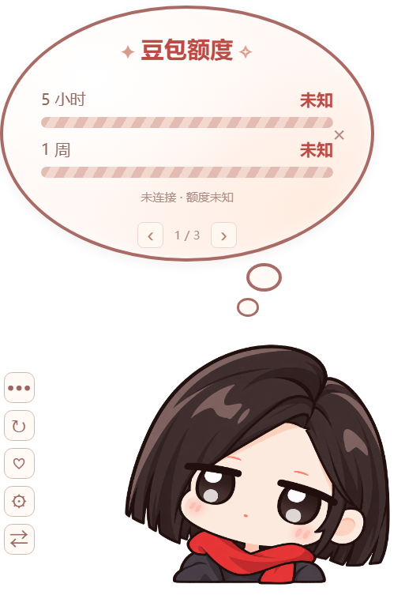

<p align="center"></p>
<h1 align="center">大肥豆插件</h1>
<p align="center">红围巾、碎碎念，还有陪你工作的豆奶。</p>
<p align="center">Windows · 豆包桌宠 · 非官方社区项目</p>



## 有什么

- 豆包 / 豆奶双形态，米白与围巾红的椭圆思考泡、两颗思考点、侧边工具栏。
- 64 条中文台词。“豆包碎碎念”页点击角色或文字换一句，气泡继续保留。
- 普通点击不改变角色图片或光感；符合条件的点击有 10% 概率触发表情彩蛋，带冷却。
- 桌面悬浮，或跟随豆包窗口；左右底角吸附，拖过中线自动翻转，分别记住两个模式的位置。
- 窗口模式下可自由拖动。挂件始终紧贴豆包的普通窗口层级；其他窗口正常遮挡豆包和挂件，切换应用不会主动隐藏挂件；豆包最小化或关闭时隐藏。
- 后台读取官方额度页面：不弹额度窗、不点击头像菜单、不抢焦点；读取完成即关闭隐藏页面。
- 设置持久化、缩放、鼠标穿透和声音开关。统计页目前显示“未知”，尚未接入本地账本。

## 0.2.1 更新

- 记住上次手动选择的豆包 / 豆奶形象，退出重开后保留，额度刷新也不会覆盖。旧设置中的启动形象会自动沿用；需要恢复按额度变身时，将“自动切换形态”关闭后重新开启。
- 优化拖动宿主时的跟随响应，保留左右停靠与窗口遮挡行为。

## 下载与启动

在 [Releases](https://github.com/Monokumakuki/doubao-nailoong-widget/releases) 下载 Windows x64 ZIP，完整解压后运行 `DouBao-Nailoong-Widget.exe`。便携包不需要安装 Node.js。

首次使用建议先启动豆包。右键角色打开设置，也可从系统托盘操作。

| 操作 | 行为 |
| --- | --- |
| 点击角色 / 侧边省略号 | 展开或收起气泡；碎碎念页点击角色换台词 |
| 拖动角色 | 移动；接近左右底角时吸附 |
| 设置或托盘 → 左下 / 右下 | 立即切换停靠位置 |
| 气泡左右箭头 | 切换额度、台词、统计页 |
| 鼠标悬停气泡 | 保持展开；移开后空闲 6 秒收起 |
| Ctrl+Shift+S | 打开设置 |
| Ctrl+Shift+R | 关闭穿透、重置位置并找回挂件 |

## 后台额度需要一次连接配置

豆包默认可能不开启 CDP。先从系统托盘正常退出豆包，再执行：

```powershell
powershell -ExecutionPolicy Bypass -File tools/start-doubao-debug.ps1 -DoubaoPath "你的豆包安装目录\app\Doubao.exe"
```

源码提供 `.cmd` 启动入口；便携包附带 `tools` 脚本。脚本保留用户数据，只添加绑定 `127.0.0.1:9225` 的调试参数，不会强制结束现有豆包。之后只启动挂件即可后台读取；若以后从普通豆包快捷方式重新启动客户端，需要再次用此入口启动豆包。

挂件每 30 秒读取当前登录会话中的官方额度页面，使用真正的 `hidden` CDP target，不打开可见标签或额度弹窗。无需提供密码、Cookie 或 Token，也不会将数据上传服务器。若客户端不支持隐藏页面、未登录或没有开放端口，显示“未知”；有历史数据时明确标记缓存 / 过期。不会自动改用前台弹窗。

已在豆包 Windows 2.32.6 验证官方“当前时段”“近 7 天”的已用 / 总额换算。界面“5 小时”沿用挂件标签，具体时段以豆包官方规则为准。额外积分不混入这两个额度。新版客户端页面结构变化可能需要更新适配器。

## 任务栏一键联动启动

源码目录和便携包均附带 `tools/install-taskbar-startup.ps1`，可安装任务栏启动补丁（不修改豆包客户端程序文件）：

```powershell
powershell -ExecutionPolicy Bypass -File tools/install-taskbar-startup.ps1 -WidgetPath "你的挂件目录\DouBao-Nailoong-Widget.exe"
```

需要豆包已固定到任务栏，固定项名为“豆包”。脚本保留原图标与 AppUserModelID 分组，把启动入口接到无控制台窗口的启动器。之后从任务栏首次启动豆包时，会同时启动挂件，并给豆包添加本机 CDP 参数。两个应用各自保证单实例。已打开豆包时，普通任务栏点击仍是切回窗口，不会重新启动进程。

安装时不强制结束豆包；如果当前豆包没有开放 CDP，请从托盘正常退出一次，再从任务栏启动。客户端未来若重新创建了固定项，可重新运行安装脚本。启动配置、原始快捷方式备份和错误日志保存在 `%LOCALAPPDATA%\DaFeiDou`。恢复原入口：

```powershell
powershell -ExecutionPolicy Bypass -File tools/install-taskbar-startup.ps1 -Restore
```

## 从源码运行

Windows 10/11 x64，Node.js 24+：

```powershell
npm ci
cmd /c tools\build-native.cmd
npm start
```

原生窗口跟随使用系统 .NET Framework C# 编译器，源码位于 `src/native/WindowFollower.cs`。JavaScript、HTML、CSS 直接运行，没有前端框架或打包器。

```powershell
npm test                              # 单元与本地 CDP 集成测试
npm run test:ui                        # 实际 Electron 界面回归
node tools/docking-check.js            # 桌面/窗口吸附和鼠标拖动，需豆包运行
node tools/follow-foreground-check.js  # 前后台层级，需豆包运行
node tools/live-quota-check.js         # 真实后台读取，需本地 CDP
npm run package                       # 构建带图标的 Windows 便携包及 SHA256 清单
```

设置存储在 `%USERPROFILE%\.doubao-nailoong-widget`，测试使用独立目录。详细验证边界见 [验收记录](docs/ACCEPTANCE.md)。这是社区预览版；长期运行、多屏混合 DPI 和所有客户端版本尚未完成验收，未承诺总内存低于 150MB。

## 结构与贡献

`src/main` 管理窗口和 IPC；`src/adapters` 负责宿主发现、后台额度与原生跟随；`src/domain` 管理状态、台词、设置和布局；`src/renderer` 渲染角色与气泡。欢迎提交台词、适配修复和问题复现步骤；反馈时请移除个人会话、账号信息及调试地址中的敏感内容。

设计与交互参考 Antigravity-Cat-Widget、codex-maid-widget 和 dsh-whale-widget。代码 MIT；角色、商标及素材权利另见 [NOTICE](NOTICE.md)。本项目不隶属于豆包或字节跳动。
